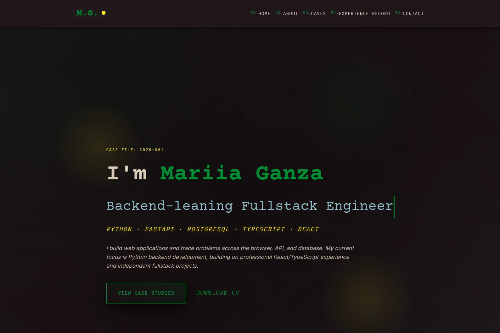
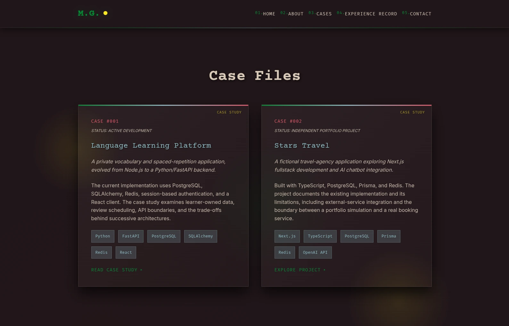
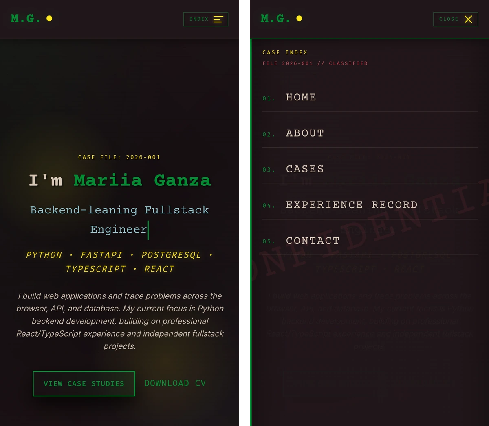

# Mariia Ganza Portfolio

[](https://github.com/marusyaganza/mariia_ganza/actions/workflows/ci.yml)

My personal portfolio site: a single page with my background, skills, projects, work history and contact links, plus long-form case studies of individual projects. It is built with Next.js, TypeScript and Tailwind CSS, in a noir detective theme: projects are "case files", the skills panel is the "evidence locker", and the work history is an "experience record".

The site itself is a static Next.js app. The backend work it presents lives in other repositories: [language-power-api](https://github.com/marusyaganza/language-power-api) (Python, FastAPI, PostgreSQL, Redis) and its React + TypeScript [client](https://github.com/marusyaganza/language-power-client). See [Related projects](#related-projects).

**Live site: [mariia-ganza.vercel.app](https://mariia-ganza.vercel.app)**





<p align="center">
  
</p>

## Status

- In active development
- Deployed on Vercel at [mariia-ganza.vercel.app](https://mariia-ganza.vercel.app) (`SITE_URL` in `src/utils/site.ts`)
- One published case study, the [Language Learning Platform](#case-studies). Stars Travel has a project card that links to its repository

## Features

- Case study pages at `/cases/<slug>`, generated from a typed registry: publishing a case creates its page and sitemap entry, and a project card can only link to a case that exists
- Every page is prerendered as static HTML at build time
- Each home page section (hero, about and skills, project cards, experience timeline, contact) has its own error boundary, so one failing section doesn't take down the page; errors are reported to Sentry
- Screenshot-based Open Graph images for the home page and for each case study, a sitemap, `robots.txt` and JSON-LD structured data
- Downloadable CV (`public/Mariia_Ganza_CV.pdf`)
- With reduced motion turned on in the OS, animations jump to their end state and the random effects are off
- Theme effects (film grain, venetian-blind shadows, spotlights, a blinking caret, an occasional neon flicker) and sound effects on navigation clicks, loaded only on the first play

## Tech stack

- Next.js 16 (App Router, Turbopack)
- React 19
- TypeScript (strict)
- Tailwind CSS 3, together with CSS modules for the theme effects
- Fonts from Google Fonts through `next/font`: Courier Prime (headings), Inter (body text), Fira Mono (labels)
- Sentry 11 (`@sentry/nextjs`) for error reporting
- Playwright for visual regression tests
- ESLint 10 (flat config, `eslint-config-next`)
- Volta with Node `24.19.0` and Yarn `4.18.1`

## Project structure

| Path | Responsibility |
| --- | --- |
| `src/app` | Routes: home page, `cases/[slug]`, error and 404 screens, the home Open Graph image, sitemap and robots |
| `src/components` | One folder per home page section (`Hero`, `About`, `Projects`, `Experience`, `Contact`), plus `Navigation`, `Footer`, `Layout` (theme effects), `Reveal` (fade-in on scroll) and `ErrorBoundary` |
| `src/components/CaseStudy` | Page shell and building blocks shared by every case study: header, side rail, table of contents, decision cards, timeline, screenshots |
| `src/content/cases` | The case studies. Each one is a folder with `meta.ts`, `Body.tsx`, its data and images, registered in `index.ts` |
| `src/hooks` | Sound effects and the ambient flicker |
| `src/utils` | Site URL and description, scrolling, reduced-motion check, Sentry options |
| `src/instrumentation*.ts`, `sentry.*.config.ts` | Sentry setup for the browser, server and edge runtimes |
| `public` | CV, icons, web manifest and sound files |
| `tests` | Playwright visual tests and their baseline screenshots |
| `docs/screenshots` | Screenshots used in this README |

## Requirements

- [Volta](https://volta.sh/)
- Node.js `24.19.0`
- Yarn `4.18.1`
- Google Chrome, for the visual tests only

Both versions are pinned in the `volta` field of `package.json`, so Volta selects them automatically inside the project directory. Without Volta, install Node 24 another way and run `corepack enable`, which picks up Yarn from the `packageManager` field.

## Local development

1. Install [Volta](https://volta.sh/).
2. Install dependencies from the lockfile:

   ```bash
   yarn install --immutable
   ```

3. Start the dev server:

   ```bash
   yarn dev
   ```

   The site runs on `http://localhost:3000`. No environment variables are needed: without a Sentry DSN, error reporting is simply off.

To check a production build locally, run `yarn build` and then `yarn start`.

## Content

The home page content lives in the section components:

| What | Where |
| --- | --- |
| Hero title and introduction | `src/components/Hero/Hero.tsx` |
| About text and skills | `src/components/About/About.tsx` |
| Project cards | `src/components/Projects/Projects.tsx` |
| Work history and education | `src/components/Experience/Experience.tsx` |
| Contact links | `src/components/Contact/Contact.tsx` |
| Site URL and description (metadata, share images) | `src/utils/site.ts` |
| CV | `public/Mariia_Ganza_CV.pdf` |

### Case studies

A case study is a folder in `src/content/cases`:

- `meta.ts`: title, summary, status, stack, table of contents, demo and repository links (typed by `CaseStudyMeta` in `types.ts`)
- `Body.tsx`: the sections, built from the components in `src/components/CaseStudy`. Each section's `id` must match an entry in `meta.toc`
- `data.ts` and images: the content the sections render

To publish one, add it to the registry in `src/content/cases/index.ts`. Its key becomes the URL slug. The page and its sitemap entry follow from the registry; its link preview is the 1200×630 `ogImage` set in the case's `meta.ts`. To link a project card to it, set `caseSlug` on the card in `Projects.tsx`. Only registered slugs type-check, so a card can't point at a case that doesn't exist. A card without a case study can set `repositoryUrl` instead.

Published so far:

- [`language-learning-platform`](src/content/cases/languageLearningPlatform): how a private vocabulary app evolved from Node.js and MongoDB to FastAPI, PostgreSQL and React

## Error reporting

Errors are reported to [Sentry](https://sentry.io) when a DSN is set. Without one (local development, tests) the SDK isn't started.

- Uncaught errors, the route error screens and the section error boundaries report to Sentry
- 10% of visits are sampled for performance tracing. There is no session replay
- No IP addresses, user info, cookie values or request bodies are collected
- Events are sent through the site's own `/monitoring` route, so ad blockers don't drop them
- Source maps are uploaded at build time, only when `SENTRY_AUTH_TOKEN` is set

| Variable | Exposed to the browser | Purpose |
| --- | --- | --- |
| `NEXT_PUBLIC_SENTRY_DSN` | Yes | Turns reporting on, in the browser and, as a fallback, on the server |
| `SENTRY_DSN` | No | Optional separate DSN for the server and edge runtimes |
| `SENTRY_ORG`, `SENTRY_PROJECT` | No | Build only. Where the source maps go |
| `SENTRY_AUTH_TOKEN` | No | Build only, secret. Uploads the source maps |

`.env.example` lists them with placeholder values. Put real ones in `.env.local` (gitignored) locally, and in the project's environment settings on Vercel. Restart `yarn dev` after changing them.

## Scripts

| Script | Description |
| --- | --- |
| `yarn dev` | Start the dev server |
| `yarn build` | Production build |
| `yarn start` | Serve the production build |
| `yarn lint` | Run ESLint |
| `yarn type-check` | Generate Next.js types (`next typegen`), then run TypeScript checks (`tsc --noEmit`) |
| `yarn test:visual` | Build the site and compare it with the baseline screenshots |
| `yarn test:visual:update` | Accept the current rendering as the new baseline |

## Testing

The visual tests screenshot the home page, the case study and the 404 page on a desktop viewport (1440 × 900) and on a mobile one (Pixel 7), plus the open mobile menu, and compare them with the baseline in `tests/visual.spec.ts-snapshots`.

- They run against a production build on port 3100, started by Playwright
- They use the installed Chrome, so no Playwright browser download is needed
- Reduced motion is on, so the random effects don't make the screenshots differ
- Sentry is turned off for test runs

I run them before and after dependency upgrades and styling refactors. The baseline images are specific to Linux and Chrome. On another OS, record your own baseline first with `yarn test:visual:update`.

There are no unit tests. The site has almost no logic of its own, so lint, type checks and the visual tests cover it.

CI (`.github/workflows/ci.yml`) installs from the lockfile, then runs lint, type checks and the production build on every push to `main` and on pull requests. The visual tests are not part of CI yet.

## Deployment

The site is deployed on Vercel. Every page is static, and the Sentry route and source map upload work through the Next.js build, so Vercel needs only two settings besides the Sentry variables: `ENABLE_EXPERIMENTAL_COREPACK=1`, so it installs with the pinned Yarn 4 instead of its default Yarn 1, and Node.js 24.x. `next.config.ts` adds `X-Frame-Options`, `X-Content-Type-Options` and `Referrer-Policy` headers to every response.

## Limitations

- The visual tests are run by hand, not in CI
- The visual baseline only matches on Linux with Chrome
- Content is written in the components and case study files; there is no CMS
- One case study so far

## Related projects

The projects the site presents:

- [language-power-api](https://github.com/marusyaganza/language-power-api): Language Power v3 backend, Python and FastAPI with PostgreSQL and Redis. The subject of the case study
- [language-power-client](https://github.com/marusyaganza/language-power-client): the React + TypeScript frontend of v3
- [language-power-v2](https://github.com/marusyaganza/language-power-v2): second version, a TypeScript monorepo with a GraphQL server and a Storybook design system
- [language-power-v1-client](https://github.com/marusyaganza/language-power-v1-client) and [language-power-v1-api](https://github.com/marusyaganza/language-power-v1-api): first version, an English-only app with an Express REST API
- [stars-travel](https://github.com/marusyaganza/stars-travel): a fictional travel agency built with Next.js, Prisma and Redis

## License

The code is [MIT](LICENSE) licensed. The CV, the written content and the screenshots are not covered.
