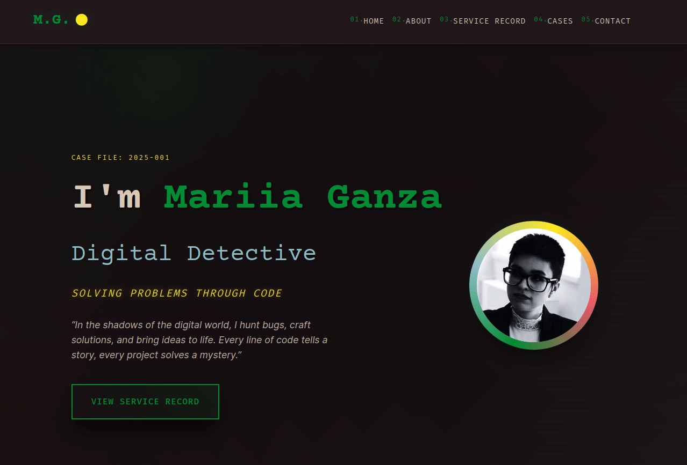

# Digital Detective Portfolio

A modern, noir-themed portfolio website built with Next.js, TypeScript, and Tailwind CSS. This portfolio showcases web development projects and skills with a unique detective/mystery theme.

## Live Preview

🔗 **[View Live Site](https://mariia-ganza.vercel.app)** 



## Tech Stack

- **Framework**: Next.js 15+ with App Router
- **Language**: TypeScript
- **Styling**: Tailwind CSS + Custom CSS
- **Fonts**: Google Fonts (Courier Prime, Inter, Fira Mono)

## Getting Started

### Prerequisites

- Node.js 24 and Yarn 4 — both pinned in `package.json`. With [Volta](https://volta.sh) installed, the right versions are picked up automatically; otherwise run `corepack enable` for Yarn.

### Installation

1. Clone the repository:
```bash
git clone git@github.com:marusyaganza/mariia_ganza.git
cd mariia_ganza
```

2. Install dependencies:
```bash
yarn
```

3. Configure environment variables:

Copy the public example, then put **real** values in `.env` and `.env.local` (both are gitignored):

```bash
cp .env.example .env
cp .env.example .env.local
```

`.env.example` only shows the shape of each variable. Next.js loads `.env` for all environments and `.env.local` on top of it. See [Environment variables](#environment-variables).

4. Run the development server:
```bash
yarn dev
```

5. Open [http://localhost:3000](http://localhost:3000) in your browser.

### Content
Update the content in each component file:
- Personal information in `Hero.tsx`
- Skills in `About.tsx`
- Experience in `Experience.tsx`
- Projects in `Projects.tsx`
- Contact information in `Contact.tsx`

### Styling
The noir detective theme is achieved through:
- Custom CSS with film grain overlays
- Venetian blinds effect
- Spotlight animations
- Dramatic lighting gradients
- Typewriter effects
- Sound effects

## Environment variables

`.env.example` is committed and contains **example** values only. Real secrets and DSNs belong in `.env` and `.env.local`, which are gitignored.

Next.js load order (later files override earlier ones): `.env`, then `.env.local`.

| Variable | Exposed to the browser | Purpose |
| --- | --- | --- |
| `NEXT_PUBLIC_SENTRY_DSN` | Yes | Sentry DSN for client, and fallback for server/edge |
| `SENTRY_DSN` | No | Optional server/edge DSN override |
| `SENTRY_ORG` | No | Sentry organization slug for source map uploads |
| `SENTRY_PROJECT` | No | Sentry project slug for source map uploads |
| `SENTRY_AUTH_TOKEN` | No | Auth token for uploading source maps |

`NEXT_PUBLIC_` is required for the client bundle (`instrumentation-client.ts`). Values without that prefix stay on the server. Restart `yarn dev` after changing env files.

On Vercel (or similar), add the same keys in the project’s environment settings.

## Available Scripts

- `yarn dev` - Start development server
- `yarn build` - Build for production
- `yarn start` - Start production server
- `yarn lint` - Run ESLint

## Credits

- Design inspired by noir detective themes
- Built with modern web technologies
- Fonts from Google Fonts
